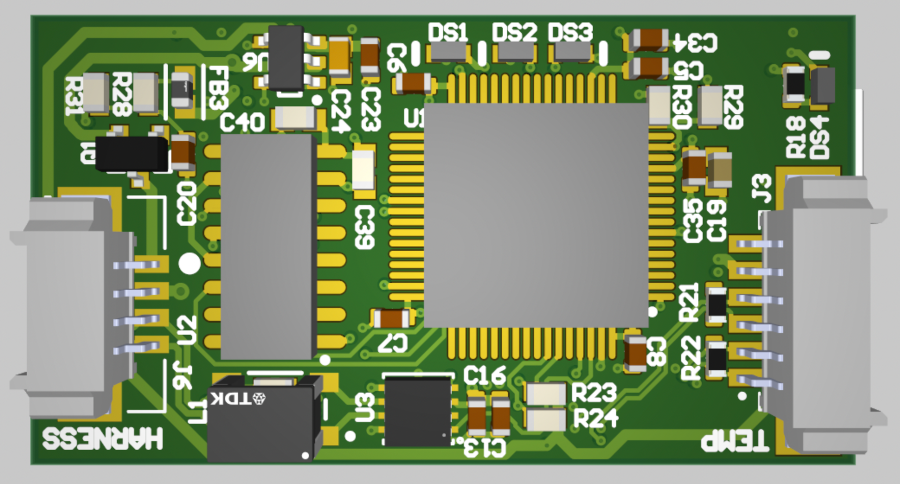
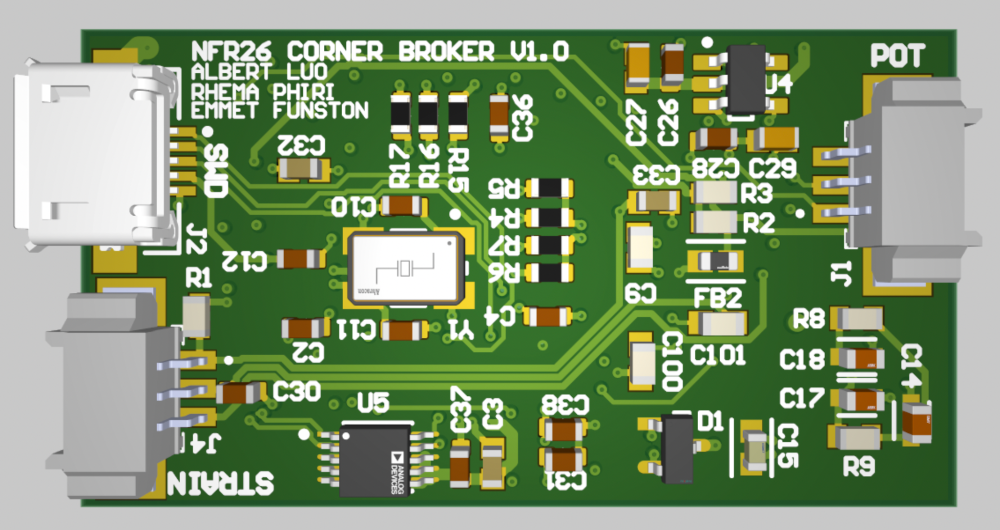
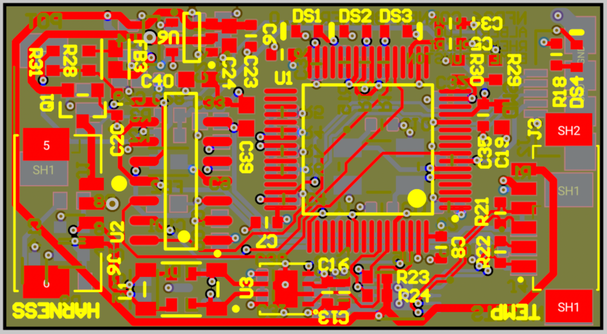
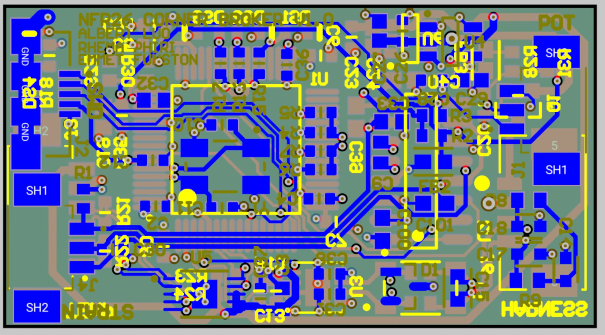
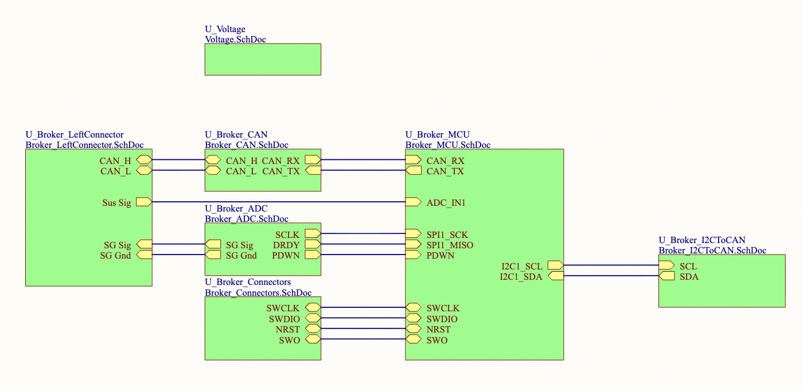

# Corner Broker | Formula SAE data acquisition board

Corner Broker is a custom sensor and CAN interface PCB for **Northwestern Formula Racing**. It brings strain-gauge and suspension-potentiometer signals into an STM32-based corner data acquisition system. This repository presents the **hardware design through schematic and PCB screenshots**; the team maintains the embedded software in [NU-Formula-Racing/daq-corner-26](https://github.com/NU-Formula-Racing/daq-corner-26).

## My contributions

- **Hardware:** Corner Broker schematic capture and PCB layout, documented by the design screenshots below. This is a team project; the screenshots are a portfolio view of the board rather than a claim of sole authorship of every subsystem.
- **Firmware:** [Added a periodic LED task for corner identification and sensor status](https://github.com/NU-Formula-Racing/daq-corner-26/commit/5db22ae43391492a719b987f8e41eef74de8965e). The commit uses a one-to-four-blink corner code, indicates whether strain-gauge data has been received, and indicates when the suspension-potentiometer reading is within its expected ADC range.

The linked [team firmware repository](https://github.com/NU-Formula-Racing/daq-corner-26) is the source of truth for software and its complete contributor history. Firmware is linked here rather than copied into this portfolio repository.

## PCB

| Top render | Bottom render |
| :---: | :---: |
|  |  |

View copper layout screenshots

| Top copper | Bottom copper |
| :---: | :---: |
|  |  |

## Hardware architecture

| Function | Design shown in the schematics |
| --- | --- |
| Controller | STM32F405RGT6 with clock, GPIO, and debug interface |
| Strain-gauge input | ADS1231 24-bit ADC with filtered analog supply |
| Suspension-potentiometer input | Analog input to the STM32 |
| Vehicle communications | TJA1051 CAN transceiver and CAN connector |
| Additional interface | LT3960 I²C-to-CAN interface |
| Power | 3.3 V and 5 V regulation from the vehicle low-voltage input |

### Schematic screenshots

| Section | Screenshot |
| --- | --- |
| Strain-gauge ADC | [View schematic](hardware/schematics/strain-gauge-adc.png) |
| Suspension-potentiometer connector | [View schematic](hardware/schematics/suspension-potentiometer-connector.png) |
| Strain-gauge connector | [View schematic](hardware/schematics/strain-gauge-connector.png) |
| STM32 GPIO and interfaces | [View schematic](hardware/schematics/stm32-gpio.png) |
| MCU power and decoupling | [View schematic](hardware/schematics/mcu-power-decoupling.png) |
| CAN transceiver | [View schematic](hardware/schematics/can-transceiver.png) |
| I²C-to-CAN interface | [View schematic](hardware/schematics/i2c-to-can-interface.png) |
| Voltage regulation | [View schematic](hardware/schematics/voltage-regulation.png) |
| Power and CAN connector | [View schematic](hardware/schematics/power-can-connector.png) |
| Debug connector | [View schematic](hardware/schematics/debug-connector.png) |

## Project status

The images document the schematic and layout design. This repository does not yet include native CAD files, fabrication outputs, assembly photos, or measured bring-up results. Those should be added only when available and cleared for publication.

**Tools and technologies:** Altium Designer, STM32, embedded C, CAN, SPI, I²C.

Northwestern Formula Racing is a collaborative team project. Hardware and software credit belongs to the respective contributors.
